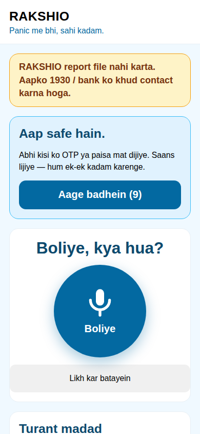
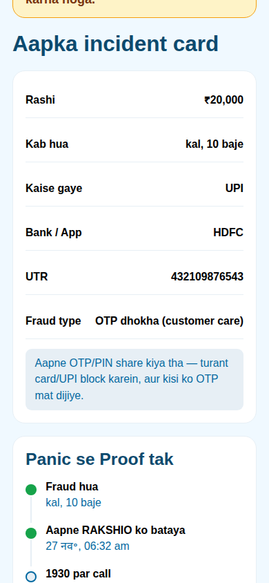
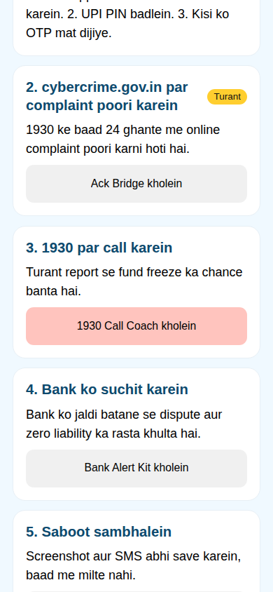

<div align="center">

[](https://bright-boba-9edf34.netlify.app)

**Voice-first cyber fraud recovery companion for India.**

[](https://bright-boba-9edf34.netlify.app)
[](https://github.com/r1shabhsharma05/RAKSHIO)
[](https://github.com/r1shabhsharma05/RAKSHIO)
[](https://github.com/r1shabhsharma05/RAKSHIO)
[](https://github.com/r1shabhsharma05/RAKSHIO)

### 👉 Try it live: [bright-boba-9edf34.netlify.app](https://bright-boba-9edf34.netlify.app)

</div>

After UPI fraud, an unauthorised debit, a fake customer-care call or an OTP
scam, the victim speaks what happened in Hindi/Hinglish — RAKSHIO extracts
the facts, confirms them back, and walks the victim through the first hour:
stop the loss, call 1930, notify the bank, complete the portal complaint.

Built for Scaler × Wispr Flow **"India Runs on Voice"** — Round 2, Track 5
(Everyday Access). Solo entry, Rishabh.

## Screenshots

| Panic | Incident | Actions |
|---|---|---|
|  |  |  |

## What RAKSHIO does NOT do

- **It never files a report.** It guides the victim to call 1930 and to file
  at cybercrime.gov.in — it does not call, file, or recover anything itself.
- **It never guarantees recovery or a refund.**
- **It never asks for or stores OTP, PIN, CVV, UPI PIN, card numbers, or
  Aadhaar.** Numbers spoken next to OTP/PIN words are masked before storage.
- **It has no backend, no API keys, no server.** All data stays in the
  browser's localStorage on the victim's own phone.

## Quick Start

```bash
npm install
npm run dev     # http://localhost:5173
npm run build   # production build (tsc strict + vite)
npm test        # vitest unit tests (26)
npx playwright test  # smoke flow + axe-core + production checks (9 tests)
npm run preview # serve the production build
```

Requires Node 20+. Speech recognition needs Chrome/Edge (Web Speech API);
without it the app silently offers Text Mode instead of a dead mic button.

## Step 1 — what works (Phase 0–1 of the master plan)

- Panic screen: giant mic, 10-second skippable calm prompt (slow TTS),
  1930 call button, bank/family placeholders labelled Step 2.
- Voice Adapter: SpeechRecognition + SpeechSynthesis behind one interface,
  hi-IN primary / en-IN fallback, silence-restart, Text Mode fallback.
- Understanding Engine: deterministic rules only, no LLM — Hindi number
  words (`bees hazaar` = 20,000, `dedh lakh` = 150,000), Devanagari digits
  and words, 12-digit UTR, bank/UPI-app lexicon, weighted fraud-type
  scorer, date/time words. Every field carries a confidence score; missing
  fields are never guessed.
- Flow: Panic → Listen → Extract → Gap questions (one at a time, "Pata
  nahi" allowed) → Confirmation gate (TTS + large text, card locked until
  amount/time/method are confirmed or marked unknown) → Incident card +
  Panic-to-Proof timeline.
- Golden Hour Clock: live timer, deadlines as data with sources (1930
  within 48h, portal within 24h, bank within 3 working days); the Action
  Queue re-orders as deadlines approach.
- 1930 Call Coach: `tel:1930` button, 30-second script from confirmed
  facts, checklist, "Done" logs only that the button was tapped.
- Demo aid: "Demo data bharo (₹20,000 UPI scenario)" fills the seeded
  story so the loop runs without a mic.

## Step 2 — what works (Phase 2 differentiators)

- **Evidence Vault:** IndexedDB + SHA-256 hash chain + redaction + Verify
  screen. Tamper test turns the chain red and names the broken record.
- **Ack Bridge:** 1930 acknowledgement number + 24-hour portal countdown +
  field-by-field Portal Copy Deck.
- **Smart Triage Router:** lost money → 1930/bank/portal; attempted fraud,
  no loss → Chakshu (Sanchar Saathi, 30 days).
- **Second-Scam Shield 2.0:** 12 weighted red-flag rules + Truth Card.
  50-message test set: **50/50 (100%)**, target was 90%.
- **Bank Alert Kit:** 10 banks, helplines verified 2026-11-27; block steps;
  pre-filled draft (review before sending — RAKSHIO never sends it);
  reference-number field; NPCI link.
- **Care Circle:** consent-first SOS card, WhatsApp deep link (number never
  stored), offline QR SOS card.
- **Bilingual Proof Pack:** Latin-script Hinglish PDF + ZIP + root-hash QR.
- **Judge Mode:** seeded ₹20,000 scenario, one button, no mic.
- **Caregiver Mode:** badge on every screen, records labelled.

## Step 3 — proof

- Vitest: 21 tests (understanding 12, shield 50-message set, vault 3,
  triage 4) — `npm test`.
- Playwright smoke flow (real Chromium): demo → confirm gate → incident
  card → Golden Hour Clock → Vault add/verify/tamper → back; plus Shield
  Truth Card — `npx playwright test`. axe-core: 0 violations on Panic and
  Incident screens. Production spec adds: offline reload via service
  worker, corrupt-storage fallback to Panic, lazy Proof load + PDF
  download + toast, Ack save/copy toasts, keyboard-focusable mic,
  render-crash fallback (fault injection).
- Docs: `docs/PRIVACY.md`, `docs/THREAT_MODEL.md`, `docs/DEMO.md` (exact
  3-minute script for 29 Nov), `docs/decisions/` (3 ADRs),
  `docs/RAKSHIO-pitch-deck.pdf` (8 slides; source `.html`, export via
  `node scripts/export-deck.mjs`).

## Step 4 — production upgrade (27 Nov)

- **Offline PWA:** service worker (`public/sw.js`, versioned cache) — app
  shell loads offline after the first visit; updates never break the panic
  path mid-session. Manifest has a stable `id`.
- **Code-splitting:** Vault, Proof and Care load on demand (React.lazy).
  First-load JS 1,287 kB → 656 kB (−49%; gzip 456 → 213 kB); the heavy
  Proof Pack (pdf-lib) only loads when opened.
- **Custom RAKSHIO theme:** Astryx `defineTheme` on the Calm palette —
  secondary buttons finally read as tappable, not disabled.
- **Error boundary + toasts + skeletons:** a render crash shows a calm
  fallback with 1930 one tap away; every save/download/copy confirms with
  a toast; Extracting and lazy screens show skeletons.
- **Polish:** inline styles 44 → 0 (classes + typed components), helper
  text at the 18px Calm minimum, dead buttons removed from Panic, OG/Twitter
  meta, shield favicon. TypeScript `strict: true`, zero `any`.
- Stack: React 19 + TypeScript + Vite — no plain-HTML pages; index.html is
  only the Vite entry shell.

## Step 5 — Damir unslop pass (27 Nov, "kill ai gradient")

- **Verdict: light slop.** Audit against the unslop signs list found one
  real sign — a blue glow halo on the giant mic button — plus small
  copy/type/motion nits. No gradients anywhere, no emoji, no hype copy.
- **Color:** mic glow (`rgba(3,105,161,0.35)` shadow) → soft neutral
  shadow; toast shadow likewise neutralised. The mic keeps prominence
  through size + solid Calm blue, not glow.
- **Copy:** "Aap safe hain." → "Aap safe hain" (headline, no trailing
  period); "Step 2 tools" → "Madad ke tools" (build-phase jargon out of
  the UI).
- **Type:** wordmark and deadline figures 800 → 700 (700 kept on buttons
  and values — legibility for elderly victims, deliberate).
- **Motion:** skeleton shimmer loop removed; loading bars are static now.
- Direction kept from Step 4: calm, exact, a little warm; help-desk
  counter world; moments = giant mic + Golden Hour Clock; signature = the
  permanent honest banner.
- Evidence: build green, vitest 26/26, Playwright 9/9, axe 0 violations;
  fresh screenshots confirm the halo is gone.

## Step 6 — dashboard rebuild (27 Nov, master-prompt + live-E2E fixes)

- **What:** the mobile-first panic app became the dark desktop dashboard
  from the approved screenshot — fixed 224px sidebar, 68px header, 12
  real routes (HashRouter, so browser Back works everywhere), Home with
  all widgets fed by real saved data, multi-incident dashboard with
  search/filter/statuses, Follow-up Guardian (1h/24h/3d/7d + .ics) and a
  Settings page. The panic flow (Panic/Listen/Gaps/Confirm) is intact as
  the Report Fraud experience; engines untouched.
- **Stack kept:** React 19 + TypeScript + Vite (no downgrade to 18).
  Added: Tailwind (utilities only, no preflight), React Router, Zustand,
  Framer Motion, Recharts, Lucide. Hand-written service worker kept
  (`rakshio-v1`); Astryx theme kept, adapted to the dark palette.
- **Six live-E2E bugs fixed** (real-Chrome walk of the Step 4 live site,
  each pinned by a Playwright test): (1) Triage + Judge had no back
  button and browser Back exited the app — both have Wapas now, routes
  are real; (2) Bank Kit draft kept saying HDFC after switching to SBI —
  the draft now follows the selected bank, and the reference-number field
  has an explicit Save button + confirmation; (3) Caregiver mode had no
  visible effect — now a badge in Panic + header, "Caregiver ne bhara
  hai" on the incident card, "(caregiver)" on vault rows; (4) Golden Hour
  Clock confused with demo data — every deadline now shows its window
  (1930 ≤48h, portal ≤24h, bank ≤3 working days) plus an explainer when
  one is overdue; (5) timeline date was mixed-script ("27 नव॰, 03:55
  pm") — now `en-IN` everywhere; the calm-prompt countdown moved out of
  the button label into its own text, and the ticking lives in a child
  component so the mic button never re-renders per second; (6) offline
  PWA reload verified by the suite's offline test — service worker
  serves the report screen with the network off. A 7th flaw found in
  post-push verification: after the report flow, Home opened scrolled
  down and the sticky header clipped the honest banner — fixed with
  ScrollToTop on every route change, test-pinned.
- **Two real bugs found by the suite itself:** a Zustand selector
  (`s.followups[id] ?? {}`) returned a fresh object on every snapshot,
  looping React to error #185 and crashing every page with follow-ups —
  fixed with a module-level cached empty object. And axe caught Astryx's
  layered `p`/`small` rules painting dark text on dark cards, plus
  secondary buttons inheriting white text on their light-blue background
  — fixed with un-layered overrides in the dark scopes.
- **Cost:** first-load JS 655.74 kB → 983.20 kB (gzip 318.96 kB) — the
  shell (router + zustand + framer-motion + lucide + Dexie); charts
  (440 kB) and proof pack (517.51 kB) stay lazy and never block paint.
- Evidence: build green, vitest 26/26, Playwright **29/29** (dashboard
  18/18 incl. the 5 fix tests + scroll-reset test, smoke 2/2, production incl. offline
  reload, shots, all-screens), axe 0 violations on home, incidents,
  Panic and Incident screens; mobile 390 no horizontal scroll.

## Step 7 — unslop pass on the dashboard (27 Nov, Damir skill)

- **Verdict: LIGHT SLOP** — direction from the existing brand (calm, exact, a little warm; night-desk incident file), palette and layout kept.
- **Fixed:** honest banner showed twice on every tool page (once from the Shell, once from each flow screen; Gaps had it 3x) — now once, owned by the Shell; Vault's evidence-type select rendered as a white bar — now dark like every other input; Incidents pie was one tiny wedge in an empty card — now a ranked status list with thin bars, bar label un-rotated ("OTP dhokha"); wordy search placeholder → "Search"; hero + stat numbers 800 → 700.
- **Kept deliberately:** green/purple Quick Action buttons (the approved photo's design), bold hero, ✓/✗ text status marks. No gradients, glows, pulse, shimmer, emoji, or exclamation marks anywhere.
- Evidence: build green, vitest 26/26, Playwright **32/32** (dashboard 20/20 incl. 2 new unslop tests), axe 0; vault + incidents screenshots re-taken after the fix and read.

## Step 8 — GSAP Home entrance + Lenis ruling (27 Nov)

- **GSAP was already in the app** (Actions, Incident, ReportFlow — 220ms crossfades). The gap was Home: no entrance animation at all. Added the same pattern to `src/dashboard/Home.tsx`: 220ms fade+rise per card, 40ms stagger, transform+opacity only, skipped under reduced motion.
- **Lenis NOT applied — its own skill forbids dashboards/app UIs** ("Never inside app dashboards"), and this is a panic app where native scroll must never delay the 1930 action.
- Evidence: build green, tsc clean, vitest 26/26, Playwright dashboard **21/21** (incl. new gsap test: cards end at opacity 1; reduced motion skips the entrance); Home screenshot read.

## Step 10 — Glassy dashboard + Step 9 fixes (27 Nov)

- **Design replaced, data kept.** The 21st.dev GlassyDashboard component (verbatim, `src/components/ui/glassy-dashboard.tsx`) replaces the old dark dashboard chrome: top pill bar (brand, search, language, Caregiver badge, Offline Ready pill, theme toggle, settings), 12-icon side dock, 5-item bottom dock, glass stage, GSAP route transitions, Manrope, light/dark themes (auto-detect, toggle in the top bar). Old `Shell.tsx` deleted. Background photo is a local copy (`public/rakshio-bg.jpg`) so the offline PWA keeps the look. Every number on screen is real saved data or the seeded ₹20,000 demo — no sample e-commerce data.
- **Language ×3:** English / Hindi (full Devanagari) / Hinglish — every dashboard string, default Hinglish; speech recognition follows the UI language (hi/hg → hi-IN). The select's options are styled dark so they read on Windows Chrome. Panic-flow strings stay Hinglish by design.
- **TTS never speaks alone:** calm card and Confirm readback are tap-only buttons now ("Suniye" / "Summary suniye").
- **Mic fixed:** permission prompt first (getUserMedia), live level meter from real mic data only, 15s no-speech window with keep-listening + Retry, distinct guidance per error (permission / network / no mic / no speech). Real-mic test still needs Rishabh on his own Chrome.
- **Situation Guide engine** (`src/engines/guide/`): deterministic on-device rules for 14 fraud situations — never called AI/ML/model anywhere. Wired after extraction, on `/guide`, and from the Shield Truth Card.
- **Sidebar fixed (live probe):** the 7 gated sections no longer show the identical "Pehle incident banayein" panel — each empty state is section-specific (what the tool does + preview + CTA). SW cache `rakshio-v2`; lazy-chunk failure now shows a reload action instead of a blank.
- **Axe/mobile fixes:** coloured buttons got white text that actually wins over the glassy CSS + deeper backgrounds (4.5:1); 390px overflow fixed (status pill, brand subtitle, top-bar Settings link hidden ≤760px — Caregiver pill stays, Settings lives in the bottom dock).
- Evidence: build green, vitest **32/32**, Playwright dashboard **29/29**, axe 0; light/dark home, empty state, Guide, Settings, mobile screenshots read. NOT deployed — live still serves Step 8.

## Step 11 — true-black dark mode + filled pages (27 Nov)

- **Dark mode is now true black, not blue.** Every dark neutral is black/grey: app `#000000`, cards `#111111`, elevated `#161616`, borders `#262626`; background photo dimmed to near-black with a flat black scrim. Accents (blue primary, red, teal, amber) stay. Light theme unchanged. The page headings were still dim blue (they sit outside the dark flow scope) — now white in dark, pinned by test.
- **Situation Guide page, filled.** Golden-hour strip first (1930 call, Bank Kit, portal link); search + category filters with counts (Sabhi 14, Paisa gaya 9, Paisa nahi gaya 1, Account 3, Call/Message 1); 3 most common pinned; every guide is a card with category, time note ("Samay kyun zaroori hai" — official windows only), recognition signs, and first step visible before clicking. Detail shows all 5 sections + related guides.
- **Every empty page, filled.** All 7 gated tools now show a "Kya yaad rakhein" checklist; Bank's empty state previews verified helplines (SBI, HDFC, ICICI, Axis — tel: links). Home's no-incident widgets teach the flow (clock "why", incident-card preview, 5-step Action Plan preview, Vault/Progress/Follow-up explainers). Incidents empty adds how-to-start steps + a Situation Guide link.
- Evidence: build green, vitest **33/33**, Playwright dashboard **32/32**, axe 0 on home + incidents + guide (light) and dark home; dark/light home, guide list + detail, bank + actions empty states, mobile 390 screenshots read. NOT deployed — live still serves Step 8.

## Step 12 — normal type scale (27 Nov)

- **Fonts are normal size now.** User call: text looked far too big. Measured before: root 18px (old Calm minimum), page headings 48px, hero 45px, body 18px. First pass: base 16px, hero 32px, page headings ≤32px, card titles 15–16px, body 16px, buttons 16px. Second pass (live E2E probe still called it oversized): hero 28px, view-head max 28px, buttons 15px, stat numbers 22px — touch targets still 48px tall. Glassy display clamps pulled down too (view-head max 49px → 28px, balance number max 57px → 34px). No layout, colour, content, route, or feature changed; pinned by a test (root 16px, headings ≤32px at 1440 + 390).
- **12 live-E2E bugs fixed in the same change.** Extraction: "7 baje bees hazaar" no longer reads ₹7 — time expressions are stripped before amount parsing, Hindi number words parse strictly (vitest on the exact sentence → ₹20,000). Languages: dashboard chrome is now fully translated — 221 keys × English/Hindi/Hinglish (Home, shell, FollowUp, Settings, empty states, Incidents); panic flow stays Hinglish by design. Light mode: glass panels raised to 78–92% opacity so text reads on the photo. Golden Hour text is deadline-aware (no more "deadlines still open" next to a "Samay khatm" chip). Coach Done toasts + logs visibly. Tamper test runs on a copy — the real evidence chain stays intact. Layout: scroll padding clears the bottom dock, flow widened, exactly one H1 per page. Shield shows an OTP info note without inflating the score. Settings label spacing fixed. Judge Mode is searchable, routable (#/judge), and linked from Home — no 13th dock item. Voice/mic live test still needs Rishabh on his own Chrome.
- Evidence: build green, vitest **37/37**, Playwright dashboard **41/41**, axe 0 in-suite (light + dark); verification screenshots read (home/bank 1366 light + dark, home 390 light + dark). NOT deployed — live still serves v6.

## Step 13 — Situation Guide: 32 situations (27 Nov)

- **18 new situations, 14 → 32.** Courier/parcel scam, lottery/prize, electricity-bill threat, matrimonial, romance/dating, fake tech-support pop-up, sextortion (video-call blackmail), card reward-points/card-block, OLX buyer, UPI collect-request, delivery-fee/address-update, crypto/fake trading app, fake visa agent, fake rental listing, gift-card, part-time task scam, fake admission/scholarship, fake travel booking. Every new guide has the same full structure (recognition, first 5 minutes, 1930/bank/portal steps, what NOT to do, evidence) and time notes use only the official windows. Most-common row is six now (UPI fraud, OTP, fake customer care, digital arrest, courier, task scam). Counts: Sabhi 32, Paisa gaya 25, Paisa nahi gaya 1, Account 4, Call/Message 2. Shield Truth Card links improved too: courier → courier guide, prize-lottery → lottery guide, UPI collect → collect-request guide. No layout, colour, font, or other feature changed; still a deterministic on-device engine — no model, no AI.
- Evidence: build green, vitest **37/37**, Playwright dashboard **42/42**, axe 0 in-suite; guide list + courier detail screenshots read (1440 + 390, no overflow). NOT deployed — live still serves v6.

## Deliberately NOT done

- Demo video (script ready in `docs/DEMO.md`, record 29 Nov).
- Dashboard submission (30 Nov 11:59 pm) — needs Rishabh's word.

## Architecture

```
src/
  voice/          VoiceAdapter (SpeechRecognition/Synthesis), prompts
  engines/
    understanding/  extract.ts — deterministic parser (Appendix A rules)
    orchestrator/   machine.ts (screen state machine),
                    deadlines.config.ts (deadlines as data + sources),
                    clock.ts (deadline states, action ordering)
  screens/        Panic, Listen, Gaps, Confirm, Incident, Actions, Coach
  dashboard/      GlassShell (Glassy design), Home, GuidePage, ToolPages,
                  SettingsPage, ReportFlow — HashRouter, 12 routes + /guide
  engines/guide/  guide.ts — deterministic situation guides (32 situations)
  theme/          rakshioTheme.ts — Astryx defineTheme on the Calm palette
  components/     Toast (confirmation toasts), ErrorBoundary (calm fallback)
  state/          store.ts — localStorage only
  demo/           seed.ts — ₹20,000 UPI demo scenario
```

Design: Calm Mode tokens (18px min text, 48px touch targets, high
contrast, one action per screen). Motion is calm only — 220ms crossfades,
press feedback, no loops, reduced-motion respected. Primitives from
Astryx (Button, Badge, Card); the giant mic button is hand-built because
no library ships a 160px calm panic button.

## Docs

- `docs/PRIVACY.md`, `docs/THREAT_MODEL.md`, `docs/DEMO.md`
- `docs/decisions/` — ADRs for the significant calls (local-only storage,
  deterministic engine, no backend, Astryx primitives).
- `docs/RAKSHIO-pitch-deck.pdf` — 8-slide pitch deck (source
  `docs/RAKSHIO-pitch-deck.html`, export with `node scripts/export-deck.mjs`).
